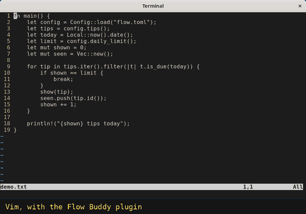
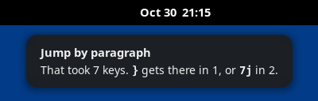
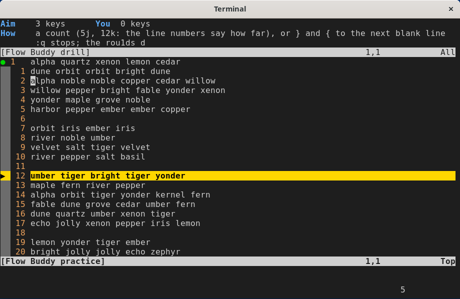

# Flow Buddy

**Improve all the time without stopping to study.**

Flow Buddy is a local coach that helps you get better at your tools as you use them. It starts with Vim. It watches how you use Vim's keys and, now and then, shows a shorter way to do what you just did, in Vim and Neovim, VS Code with vscodevim, vi-mode shells, and Claude Code's Vim mode. It learns which commands you already use, so the tips move on as you do. Your keys never leave your machine.

<p align="center"></p>

> **Status:** 0.1, early. Built and used on GNOME 50. See [what's coached where](docs/coverage.md) and the [changelog](CHANGELOG.md).

## Quick start

On Linux with GNOME 50 (or any X11 desktop), with bash, zsh or fish:

```sh
git clone https://github.com/AbdelrahmanWM/Flow-Buddy && cd Flow-Buddy
scripts/install.sh --with-udev    # builds with Rust; a release download needs none
# log out and back in, then:
flowbuddy tour                    # how it works, a sample tip, and the settings that matter
```

[docs/install.md](docs/install.md) has release downloads, keyboard access, the editor plugins, updating and uninstalling.

## Privacy, in three lines

- Keys are turned into counts and habits in memory ("`j` seven times in a row"). What you type, file names and window titles are never stored or sent.
- The daemon that reads keys has no network code, and a test enforces that. The AI features are off unless you choose a provider, and `--prompt` shows exactly what would be sent.
- `flowbuddy memory show` shows everything that's kept, and `flowbuddy memory forget --all` deletes it. The details are in [docs/privacy.md](docs/privacy.md).

## What it coaches

| You did | Try |
|---|---|
| `jjjjjj` to a blank line | `}` |
| `llllll` to a character | `f<char>`, `w`, `e` |
| `kkkk…` to the top of the window | `H` |
| `xxxx` | `dw` / `de` |
| Arrow keys in Normal mode | `h` `j` `k` `l` |
| `x` then `i`, `dw` then `i` | `s`, `cw` |
| `viwd`, `Vjjd` | `diw`, `3dd` |
| The same change again | `.` |
| The same edit on every line | a macro: `qq…q`, `@q` |
| `n.n.n.` through search matches | `cgn` then `...`, or `:%s` |
| `uuuuuuu` | `7u`, `:earlier 1m` |
| `I// <Esc>j` on line after line | `Ctrl-v`, `j`…, `I`, type once |
| Yank, delete, `p` pastes the wrong thing | `"0p` |
| `Ctrl-w w` round the windows, `:bn :bn :bn` | `Ctrl-w h/j/k/l`, `:b name`, `Ctrl-^` |
| `:w` then `:q` | `:wq` or `ZZ` |
| `↑↑↑↑` hunting shell history | `Ctrl-r` |

`flowbuddy rules` lists every rule, and [docs/coverage.md](docs/coverage.md) shows what's coached in each place. Exact motion tips need the editor plugins, which report where a move ended as numbers and never send text: [vim-plugin](vim-plugin/README.md) and [vscode-extension](vscode-extension/README.md). The installer adds both when it finds the editors.

## What it looks like

| | |
|---|---|
|  | Everywhere else, a tip shows as a card under the top bar for a few seconds. |
|  | The top-bar menu keeps the tip, what it does, and its answers, with keyboard shortcuts. |
|  | `flowbuddy practice`: reach the marked line, delete the marked words, in as few keys as you can. |
|  | The tour, in the settings window or in a terminal (`flowbuddy tour`). |

The pictures are made by `scripts/screenshots/shoot.sh`, in a throwaway GNOME session.

## More than tips

- **A daily lesson:** one command you don't use yet, with a worked example, and reviews for ones you stop using.
- **`flowbuddy practice`:** two-minute drills in Vim that count your keys against the fewest that would do.
- **`flowbuddy learn --map`:** every skill as a tile: used, slipping, learning, or ready.
- **`flowbuddy coach`:** ask an AI of your choice (your Claude subscription, an API, or a local model) about your habits.

[docs/usage.md](docs/usage.md) has every command and setting. On GNOME, **Settings…** in the top-bar menu has them all in a window.

## Why

- Learning happens in big blocks (tutorials, courses) that rarely turn into habits. A tip about what you did a second ago does.
- Tools like hardtime.nvim block or punish. Flow Buddy suggests, and never stops you.
- A tool that reads your keys has to be open to inspection, and has to keep its data local.

## Where it runs

Linux: GNOME on Wayland (with the top-bar indicator and the settings window), or any X11 desktop such as KDE, Xfce or i3 (tips as notifications). Not yet KDE on Wayland (#123) or macOS.

## Contributing

Bug reports, wrong tips and new rules are all welcome: see [CONTRIBUTING.md](CONTRIBUTING.md). [docs/architecture.md](docs/architecture.md) explains how it works, and [docs/writing-rules.md](docs/writing-rules.md) how to add a rule. To report a security problem, see [SECURITY.md](SECURITY.md).

## License

[MIT](LICENSE)
