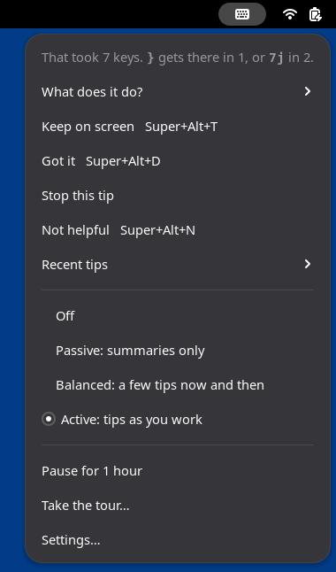
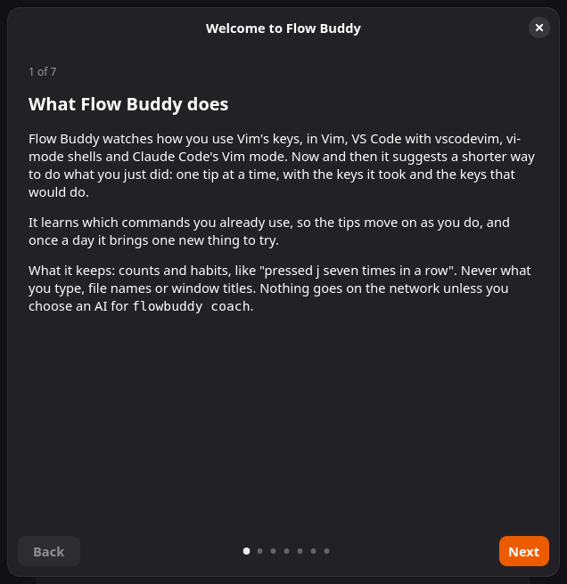

# Flow Buddy

**Improve all the time without stopping to study.**

Flow Buddy is an adaptive tutor that lives inside your work. It watches how you actually use your tools, works out what you know and what you're ready for next, and teaches it at the moment it's useful. Then it checks whether the teaching worked. There are no courses to sit through and no time set aside: you get better at the tool while you use it.

Vim is the first subject, in Vim and Neovim, VS Code with vscodevim, vi-mode shells and Claude Code's Vim mode. It runs on your machine, and your keys never leave it.

<p align="center"></p>

## How it teaches

Most tools that teach a skill tell everyone the same thing once and never find out if it stuck. Flow Buddy keeps a model of you, and runs a loop on it:

1. **It notices what you do.** Your keys and the editor plugins' reports become habits: "`j` seven times to reach a blank line", "`x` four times then `i`". Counts only, never text.
2. **It knows what you know.** Each of the 178 skills in its curriculum (covering every command in Vim's `:help index`) has a mastery estimate, updated each time you use the skill or fall back on the habit it replaces (knowledge tracing). `flowbuddy learn --map` shows them all.
3. **It teaches one step up, at the right moment.** A tip comes right after the habit, naming the shorter way. It only suggests what you're ready for: never `ci(` before you use `ciw`, or `t` before `f`. Once a day there's a lesson, one new skill with a worked example, followed by a challenge to use it the next time it fits.
4. **It keeps what you learned.** Each skill has a memory half-life, fitted to your own gaps between uses (half-life regression, as in Duolingo). When the chance you'd recall a skill drops, it comes back as a review. `flowbuddy practice` drills the habit you trip on most.
5. **It checks that it works.** It records whether you start using the better way after a tip. A random 10% of tips are held back, so the effect of tips can be measured against not showing them. A learned filter drops the tips you find unhelpful. `flowbuddy learn --report` and the weekly summary show the results.

Each of these choices rests on published research on memory and skill learning, listed in [docs/learning.md](docs/learning.md), and each is measured on you rather than assumed.

> **Status:** 0.1, early. Built and used on GNOME 50. See [what's coached where](docs/coverage.md) and the [changelog](CHANGELOG.md).

## Quick start

On Linux with GNOME 50 (or any X11 desktop), with bash, zsh or fish:

```sh
git clone https://github.com/AbdelrahmanWM/Flow-Buddy && cd Flow-Buddy
scripts/install.sh --with-udev    # builds with Rust; a release download needs none
# log out and back in, then:
flowbuddy tour                    # how it works, a sample tip, and the settings that matter
```

Or, to try it in Vim, Neovim and VS Code without giving it your keyboard:

```sh
scripts/install.sh --editor-only  # then open your editor; see "Two ways to install"
```

[docs/install.md](docs/install.md) has release downloads, keyboard access, the editor plugins, updating and uninstalling.

## Privacy, in three lines

- Keys are turned into counts and habits in memory ("`j` seven times in a row"). What you type, file names and window titles are never stored or sent.
- The daemon that reads keys has no network code, and a test enforces that. The AI features are off unless you choose a provider, and `--prompt` shows exactly what would be sent.
- `flowbuddy memory show` shows everything that's kept, and `flowbuddy memory forget --all` deletes it. The details are in [docs/privacy.md](docs/privacy.md).

## Examples of what it coaches

| You did | Try |
|---|---|
| `jjjjjj` to a blank line | `}` |
| `llllll` to a character | `f<char>`, `w`, `e` |
| `kkkk…` to the top of the window | `H` |
| `xxxx` | `dw` / `de` |
| Arrow keys in Normal mode | `h` `j` `k` `l` |
| `x` then `i`, `dw` then `i` | `s`, `cw` |
| `viwd`, `Vjjd` | `diw`, `3dd` |
| The same change again | `.` |
| The same edit on every line | a macro: `qq…q`, `@q` |
| `n.n.n.` through search matches | `cgn` then `...`, or `:%s` |
| `uuuuuuu` | `7u`, `:earlier 1m` |
| `I// <Esc>j` on line after line | `Ctrl-v`, `j`…, `I`, type once |
| Yank, delete, `p` pastes the wrong thing | `"0p` |
| `Ctrl-w w` round the windows, `:bn :bn :bn` | `Ctrl-w h/j/k/l`, `:b name`, `Ctrl-^` |
| `:w` then `:q` | `:wq` or `ZZ` |
| `↑↑↑↑` hunting shell history | `Ctrl-r` |

`flowbuddy rules` lists every rule, and [docs/coverage.md](docs/coverage.md) shows what's coached in each place. Exact motion tips need the editor plugins, which report where a move ended as numbers and never send text: [vim-plugin](vim-plugin/README.md) and [vscode-extension](vscode-extension/README.md). The installer adds both when it finds the editors.

## What it looks like

| | |
|---|---|
|  | Everywhere else, a tip shows as a card under the top bar for a few seconds. |
|  | The top-bar menu keeps the tip, what it does, and its answers, with keyboard shortcuts. |
|  | `flowbuddy practice`: reach the marked line, delete the marked words, in as few keys as you can. |
|  | The tour, in the settings window or in a terminal (`flowbuddy tour`). |

The pictures are made by `scripts/screenshots/shoot.sh`, in a throwaway GNOME session.

## Your progress

- **`flowbuddy learn --map`:** every skill as a tile: used, slipping, learning, ready, or later.
- **`flowbuddy summary --week`:** what got better this week, against before.
- **`flowbuddy learn --report`:** whether tips, lessons and drills are working, with the held-back tips for comparison.
- **`flowbuddy coach`:** optionally, ask an AI of your choice (your Claude subscription, an API or a local model) about your habits. It's sent counts, never your text.

[docs/usage.md](docs/usage.md) has every command and setting. On GNOME, **Settings…** in the top-bar menu has them all in a window.

## Why

- **Courses don't become habits.** People learn tools in big blocks, then fall back on what they already do. A tip about what you did a second ago, repeated until you use the better way, does become a habit.
- **Nothing else knows you.** Cheat sheets and tip-of-the-day show everyone the same things. Habit tools like hardtime.nvim only block keys. Flow Buddy keeps a model of what you know and teaches the next step from there, and it never stops you from typing.
- **It has to be trustworthy.** A tool that reads your keys has to keep its data local and be open to inspection.

## Beyond Vim

The parts that teach (the habit rules, the skill model, the reviews, the measurement) don't depend on Vim. Vim comes first because its keys are a skill with a lot of room to grow. The shell is a second, smaller pack (`cd ..` again and again, `Ctrl-r` for history). Next are the browser with Vimium (#124) and JetBrains IDEs (#125). If there's a tool you'd like Flow Buddy to teach, open a discussion.

## Two ways to install

| | Editor only | Full |
|---|---|---|
| Install | `scripts/install.sh --editor-only` | `scripts/install.sh --with-udev`, then log out and back in |
| Keyboard access | none | reads the keyboard (see [privacy](docs/privacy.md#keyboard-access)) |
| Vim and Neovim: motions, text objects, operators, repeats, mistakes | ✓ | ✓ |
| VS Code with vscodevim | motions and repeats, counted from single cursor steps | everything |
| `:` command tips, and tips for what you do in Insert mode | | ✓ |
| The shell's vi mode, shell commands, Claude Code's Vim mode | | ✓ |
| Tips | in the editor | in the editor, the top bar, notifications |
| Lessons, reviews, practice, the skill map, summaries, `coach` | ✓ | ✓ |
| Runs as | started by the editor plugins; stops when the last editor has been closed for ten minutes | a service |

Editor only is the quick way to try it: the plugins tell the daemon what you type in Vim's moving modes (never Insert or the command line), and nothing reads your keyboard. Both use the same database, so moving up to the full install later keeps everything.

## Where it runs

Linux. The full install: GNOME on Wayland (with the top-bar indicator and the settings window), or any X11 desktop such as KDE, Xfce or i3 (tips as notifications). Editor only: any Linux desktop, including KDE on Wayland. Not yet macOS.

## Contributing

Bug reports, wrong tips and new rules are all welcome: see [CONTRIBUTING.md](CONTRIBUTING.md). [docs/architecture.md](docs/architecture.md) explains how it works, and [docs/writing-rules.md](docs/writing-rules.md) how to add a rule. To report a security problem, see [SECURITY.md](SECURITY.md).

## License

[MIT](LICENSE)
