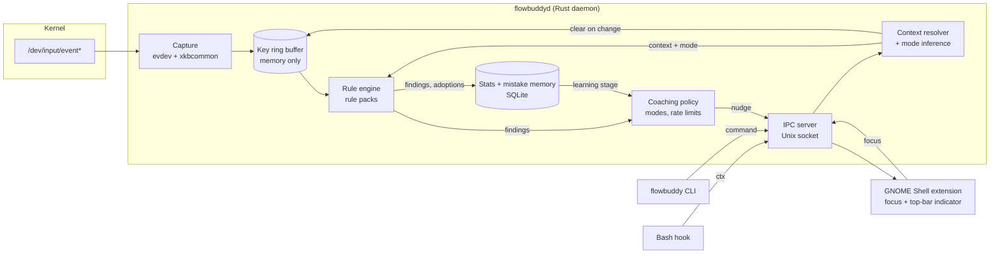

# Architecture

This document explains how Flow Buddy's pieces fit together. Privacy rules that apply everywhere are in [privacy.md](privacy.md). When this document and the code disagree, fix one of them.

## Components



| Component | Lives in | Responsibility |
|---|---|---|
| Capture | `crates/daemon` | Reads keyboards through evdev without grabbing them (#6). Translates keycodes into keys using xkbcommon (#7). |
| Key ring buffer | `crates/daemon` | Holds the last ~64 keys in memory, and only while a supported context is focused (#8). |
| IPC server | `crates/daemon` | Unix socket that speaks JSON lines; all other processes talk to the daemon through it (#10). |
| Context resolver | `crates/daemon`, model in `crates/core` | Combines focus and terminal reports into a `Context`, and infers the Vim mode (#13–#16). |
| Rule engine | `crates/core` (`rule`, `engine`, `rules/`) | Turns mode-tracker steps into findings and adoptions (#17–#22). Rules never see raw keys. |
| Coaching policy | `crates/core` | Decides whether, when and what to nudge, based on the mode, rate limits and learning stage (#23, #25). |
| Stats + mistake memory | `crates/daemon` | Stores aggregates, pattern records and abstract episodes in SQLite (#27, #30–#33). |
| GNOME Shell extension | `gnome-extension/` | Reports the focused window and shows nudges in the top bar (#11, #24). |
| Bash hook | `shell/flowbuddy.bash` | Reports the foreground command *name* for each shell (#12). |
| CLI | `crates/cli` | `status`, `mode`, `pause`, `rules`, `summary`, `memory`, `ctx` |

### Data flow for one key

1. Capture reads a key event and translates it, e.g. into `j`.
2. If the current context is `Unsupported`, the key is dropped right away.
3. Otherwise the key is pushed into the ring buffer and passed to mode inference, which updates the mode and its confidence.
4. If the mode is confident, the engine hands `(key, mode, context)` to each rule that is enabled for this context.
5. A rule may emit a `Finding` (an inefficiency) or an `Adoption` (you used the better command). Both update stats and the mistake memory, as counts and shapes only.
6. The coaching policy decides whether a finding becomes a nudge now, later (batched), or never.

## Context model

```rust
enum ContextKind {
    VsCodeVim,   // VS Code focused (vscodevim assumed)
    TerminalVim, // terminal focused, foreground command is vim/vi
    BashVi,      // terminal focused, shell at prompt, vi-mode on
    Unsupported, // anything else: keys are dropped
}

enum VimMode { Normal, Insert, Visual, VisualLine, VisualBlock, Cmdline, OpPending }

struct Context {
    kind: ContextKind,
    mode: VimMode,    // readline vi uses only Normal/Insert
    confident: bool,  // rules fire only when true
}
```

### Resolving the context

| Focused app (from extension) | Terminal report (from hook) | Context |
|---|---|---|
| VS Code, companion says a panel has focus | — | `Unsupported` |
| VS Code (`code`, `code_code` for the snap) | — | `VsCodeVim` |
| Terminal emulator, Vim plugin inside it (see below) | — | `TerminalVim` |
| Terminal emulator | foreground `vim`/`vi`/`nvim` | `TerminalVim` |
| Terminal emulator | at prompt (`ctx prompt`) | `BashVi` |
| Terminal emulator | other foreground command, or no report | `Unsupported` |
| Anything else | — | `Unsupported` |

The app ids are defaults and can be overridden in the config. The values seen on GNOME 50 are in [spikes/gnome-focus.md](spikes/gnome-focus.md).

**Matching a terminal window to a shell.** The extension reports the focused window's PID, and each hook report carries the shell's `$$` and TTY. The daemon walks the shell's parent processes until it reaches the window PID.

**Editor plugins** take part when they're connected (see [Editor clients](#editor-clients)):
- The VS Code companion reports editor focus. Its heartbeat also gates findings: keys that came with no editor activity in the last 2 s went to a terminal, chat or other panel, so they aren't coached.
- A Vim plugin whose process descends from the focused terminal makes the context `TerminalVim`, wherever Vim was started from (for example by `git commit`). If it has reported focus, that decides. Otherwise it wins only if it was active after the last shell report.
- A Vim plugin that isn't a child of the terminal (inside tmux) counts when it has said it has focus.
- An editor's reported mode replaces the guess, and stays known after clicks.

**Other desktops.** On an X11 session (KDE, Xfce, i3, GNOME on Xorg) the daemon reads the focused window itself: `_NET_ACTIVE_WINDOW`, the window's class (as the app id) and its pid, twice a second, never its title. It talks to the X server over its Unix socket, which the sandbox allows. The service needs `DISPLAY` in its environment, which most desktops pass to user services. There is no top-bar indicator there, so tips arrive as desktop notifications. KDE on Wayland needs a KWin script (#123).

**Keyboard layout.** The extension reports the current input source (`input_source`, xkb names such as `de` and `nodeadkeys`) and every switch. Built with libxkbcommon (`scripts/install.sh` does when `libxkbcommon-dev` is installed), the daemon rebuilds its keymap for it. For non-Latin layouts it uses US, since that's where Vim commands are typed. `[keyboard] xkb_layout` in the config overrides it. Without libxkbcommon, keys are read as US and `flowbuddy status` says so.

**tmux.** Inside tmux, the terminal's shell reports `tmux` as its foreground command, and the panes' shells aren't its children. The daemon then asks tmux which pane the client on that terminal's tty shows, and what runs in it (`tmux list-clients -F '#{client_tty} #{pane_pid} #{pane_current_command}'`): Vim there is `TerminalVim`, a pane shell whose hook reported a vi-mode prompt is `BashVi`. Switching panes sends no event, so this is checked again every second while tmux is involved. tmux is reached over its Unix socket, which the daemon's sandbox allows.

**One server for many windows.** GNOME Terminal and Ptyxis run one server process for all their windows, so several shells can match the same window. The daemon uses the shell that reported most recently; editor plugins that report focus settle it for Vim.

### Mode inference and confidence

- With an editor plugin connected, the editor's own mode is used. Otherwise:
- Mode is inferred from keys by a state machine for each context (#14, #15). It knows vim-surround (`ys`, `cs`, `ds`) and commentary (`gc`) so they don't throw it off; none of those is a built-in sequence.
- **Esc** (or `Ctrl-[`) always resyncs to Normal and sets `confident = true`.
- Anything the daemon can't see sets `confident = false` until the next Esc. Examples: a mouse click, opening the VS Code command palette, a focus change, or an unrecognized key sequence (#16).
- Rules never fire while `confident` is false. This avoids false nudges, at the cost of missing some real ones.

## Coaching modes

| Mode | Captures | Live nudges | Summary |
|---|---|---|---|
| `off` | No (buffer cleared) | No | On demand, past data only |
| `passive` | Yes | No | On demand + one end-of-day notification |
| `balanced` (default) | Yes | Batched: up to 1–2 tips every N minutes (default 30) | On demand |
| `active` | Yes | Real time, with a cooldown per rule and a cap per hour | On demand |

**The learned tip filter** (`[ai] filter`, on by default) is a small logistic regression trained hourly on what happened after your tips: adopted, dismissed, not helpful, or ignored. It uses the rule, context, learning stage, time of day, mode, and how many tips came before that day. Before a tip is shown, it predicts the chance you'll act on it, and skips it below 12%. It does nothing until it has 30 outcomes, never hides a rule's first three tips, and lets every fifth skipped tip through so it keeps learning. `flowbuddy status` shows what it's doing. No LLM is involved, and nothing leaves the machine.

**Something new every day** (`[learn] daily`, on by default, every mode but off): once a day, while you're in Vim and no tip came in the last five minutes, one feature you don't use yet from a curriculum of about 50, ordered from basic to advanced (`crates/core/src/curriculum.rs`). Each item recognises itself in the key tracker's steps, so Flow Buddy counts which ones you use (per day, by id only) and skips what you know. An item you start using three times is learned. One you don't is shown again after a week, at most three times. `flowbuddy learn` shows the latest item and your progress.

Rules learn from "not helpful" reports: every two in two weeks raise that rule's threshold by one, at most three above its default. A threshold set in `config.toml` is never changed, and `flowbuddy rules reset <id>` undoes the raises.

Once a week, in every mode but `off`, one notification sums up progress: how often you used the better way, habits that showed up less than the week before, habits mastered, and what to work on next. It is sent at `summary_time`, outside quiet hours and pauses.

These apply in every mode:
- quiet hours
- `pause <duration>`
- muting individual rules
- no nudges for patterns the mistake memory marks as `mastered`, except a spaced check-in if the habit shows up again: one is allowed a week after mastering it, the next after two more weeks, then four, and so on
- in `balanced` mode, the habit picked to work on next (`flowbuddy next`) counts double when choosing a batch's tips

Nudges come back once a pattern `regressed`.

**Learning stages** (#31): `new → nudged → improving → mastered`, and `mastered → regressed → improving`. Moving between stages depends on how often the mistake happens and how often you adopt the better command, measured over sliding windows. Strong evidence moves a stage sooner: when even the low end of an 80% Wilson interval on the adoption ratio clears the bar (a little below the fixed ratios), so eight better-way uses with no slips count as mastered without waiting for ten events. `flowbuddy memory show` shows each habit's ratio and its likely range.

## IPC protocol v0

- **Transport:** Unix stream socket at `$XDG_RUNTIME_DIR/flowbuddy.sock`, file mode `0600`.
- **Framing:** one JSON object per line (UTF-8, `\n`-terminated).
- **Envelope:** every message has `v` (protocol version, currently `0`) and `type`.
  - Requests may carry an `id`, which the daemon echoes back in the reply.
  - When the daemon gets an unknown `v`, it replies with an `error` and closes the connection.
  - When it gets an unknown `type`, it replies with an `error` and keeps the connection open.

The first message on every connection is `hello`. Short-lived clients (the CLI, the bash hook) send `hello` followed by one request, then disconnect. The extension stays connected and receives `nudge` messages pushed by the daemon.

### Client → daemon

**`hello`**: identifies the client.
```json
{"v":0,"type":"hello","client":"gnome-extension","client_version":"0.1.0"}
```
`client` is one of `gnome-extension`, `cli` or `bash-hook`.

**`focus`**: the focused window changed. Sent by the extension.
```json
{"v":0,"type":"focus","app_id":"code_code","pid":41230}
```
When nothing is focused, `app_id` is `null`. The protocol accepts an optional `title`, but the extension doesn't send it. Titles often contain file names, and the resolver doesn't need them.

**`ctx`**: report from the shell hook. Sent once when a command starts and once when the prompt returns.
```json
{"v":0,"type":"ctx","event":"fg","command":"vim","shell_pid":51002,"tty":"/dev/pts/3"}
{"v":0,"type":"ctx","event":"prompt","vi_mode":true,"shell_pid":51002,"tty":"/dev/pts/3"}
{"v":0,"type":"ctx","event":"fg","command":"cd","shell_pid":51002,"shape":"cd-up"}
```
`command` is the basename of the command only, never its arguments. `vi_mode` comes from the shell (`$SHELLOPTS` in bash, `bindkey` in zsh, `$fish_key_bindings` in fish). If it's false, the daemon treats the prompt as `Unsupported`. `shape` (optional) is one of `cd-up`, `cd-up-many`, `reused-arg` and `one-word-changed`, worked out by the hook from the command line and the one before it, which stay in the shell; it feeds the `shell` pack.

**`nudge_response`**: the user acted on a nudge in the indicator.
```json
{"v":0,"type":"nudge_response","nudge_id":"n-1729740000-3","action":"dismiss"}
```
`action` is one of `seen` (shown and timed out), `dismiss`, `mute_rule` or `false_positive`.

**`pointer_click`**: a mouse button was pressed or the touchpad tapped, anywhere. Sent by the extension; it carries no position and no target. A click can change the editor's mode, so the daemon stops trusting its mode guess until the next Esc.
```json
{"v":0,"type":"pointer_click"}
```

**`command`**: a request from the CLI or the indicator menu.
```json
{"v":0,"type":"command","id":7,"name":"status"}
{"v":0,"type":"command","id":8,"name":"set_mode","args":{"mode":"active"}}
{"v":0,"type":"command","id":9,"name":"pause","args":{"seconds":3600}}
{"v":0,"type":"command","id":10,"name":"resume"}
{"v":0,"type":"command","id":11,"name":"rule","args":{"rule_id":"vim.repeat-jk","action":"disable"}}
{"v":0,"type":"command","id":12,"name":"summary","args":{"period":"today"}}
```
`summary` and `memory` read SQLite directly in the CLI (which is read-only). Going through the daemon is still allowed, so the extension can use the same requests.

### Daemon → client

**`welcome`**: the reply to `hello`.
```json
{"v":0,"type":"welcome","daemon_version":"0.1.0","mode":"balanced"}
```

**`ack`**: a request succeeded and has no other result.
```json
{"v":0,"type":"ack","id":8}
```

**`result`**: a request succeeded and returns data.
```json
{"v":0,"type":"result","id":7,"data":{"running":true,"mode":"balanced","paused_until":null,"context":"vscode-vim","app":"code_code","clients":["gnome-extension"]}}
```
`status` reports the *kind* of context and the focused app's id, never keys or titles.

**`error`**: something went wrong.
```json
{"v":0,"type":"error","id":11,"code":"unknown_rule","message":"no rule named vim.repeat-jk"}
```
`code` is one of `bad_version`, `bad_request`, `unknown_type`, `unknown_rule` or `internal`.

**`nudge`**: shows a hint. Pushed to the extension.
```json
{"v":0,"type":"nudge","nudge_id":"n-1729740000-3","rule_id":"vim.repeat-jk","title":"Try a count","text":"You pressed j 7 times. Try 7j, } or Ctrl-d.","ttl_ms":6000,"style":"card"}
```
In `balanced` mode, one batch may contain several `nudge` messages. `style` is `card` (a card at the top centre of the screen that fades out, the default in `active` mode) or `bar` (a label next to the top-bar icon, the default otherwise); `[coaching] nudge_style` overrides it. It was added after v0 shipped, so it is optional and defaults to `bar`. Either way the icon shows a dot until the menu is opened.

Commands in `text` are marked with backticks, the Markdown way ("Try `` `Ctrl-d` `` then `` `5j` ``"); the extension shows them in a monospace font. `explain` (optional) has one line per piece of those commands, such as "`` `Ctrl-d` ``: down half a page", from the glossary in `crates/core/src/glossary.rs`. The extension shows it in a collapsed "What does it do?" section of the menu; plain notifications drop the markers and append it.

**`mode_changed`**: the coaching mode changed. Broadcast to clients that stay connected, so the indicator stays in sync.
```json
{"v":0,"type":"mode_changed","mode":"active","paused_until":null}
```

### Editor clients

Keystrokes alone can't show which pane of an editor has focus, what mode it's really in, or where a movement was heading. Editor plugins report those, as numbers and flags only, never text, file names or paths. They connect like the extension, saying which editor they are and their process id:

```json
{"v":0,"type":"hello","client":"editor","client_version":"0.1.0","editor":"vim","pid":61234}
```

`editor` is `vscode`, `vim` or `nvim`. Then:

**`editor_focus`**: whether a text editor has keyboard focus. In VS Code, `false` means the terminal, a chat or another panel; in a terminal Vim, it follows the terminal's focus events.
```json
{"v":0,"type":"editor_focus","focused":false,"panel":"terminal"}
```
`panel` (optional, when not focused) is `terminal` or `other`. With Claude Code running in VS Code's terminal and its Vim mode on, the terminal panel is coached as `claude-vim`.

**`editor_mappings`**: your key mappings that matter for following the mode: two-key Insert-mode mappings to Esc (`jk`), and Normal-mode keys mapped to something else (their keys only, no right-hand sides). The tracker reads `jk` as Esc and treats a remapped key as unknown instead of as the built-in command. Without a plugin, `[keyboard] insert_escapes = ["jk"]` does the same.
```json
{"v":0,"type":"editor_mappings","insert_escapes":["jk"],"normal":["H"]}
```

**`editor_mode`**: the editor's real mode, one of `normal`, `insert`, `replace`, `visual`, `visual_line`, `visual_block`, `cmdline`, `op_pending`, `other`. It replaces the daemon's guess.
```json
{"v":0,"type":"editor_mode","mode":"visual_line"}
```

**`motion`**: one movement in Normal or Visual mode, from the first cursor move until it rests for about a second.
```json
{"v":0,"type":"motion","start_ms":1729740000000,"end_ms":1729740000900,"moves":12,"mode":"normal","lines":12,"cols":0,"facts":{"paragraph_hops":2,"window_lines":40}}
```
`lines` and `cols` are deltas, never positions; times are Unix epoch milliseconds, so the daemon can count the keys it saw in that window. `facts` describe the end position (see `MotionFacts` in `crates/core/src/editor.rs`), for example "`}` twice lands exactly here" or "`f` plus the target character, then `;` twice". The character itself is never sent. Every editor message rejects unknown fields, so nothing text-like can be added by accident.

**`operator`**: `d`, `c` or `y` ran and its range was exactly these text objects, best match first. Names come from a fixed list (`iw`, `aw`, `iW`, `aW`, `ip`, `ap`, `i(`/`a(`, `i[`/`a[`, `i{`/`a{`, `i<`/`a<`, and the quotes); the text is never sent.
```json
{"v":0,"type":"operator","op":"delete","at_ms":1729740000500,"objects":["i(","a("]}
```
The daemon adds up the keys behind it: the operator plus the motions just before it that moved the cursor into place. A text object works from anywhere inside, so `F(ldt)` (6 keys) becomes "`di(` does it from anywhere inside, in 3".

These were added after v0 shipped. They are new message types and optional fields only, so the version stays 0.

## Storage layout

| Path | Contents |
|---|---|
| `~/.config/flowbuddy/config.toml` | Written by you: default mode, intervals, quiet hours, rule settings, app-id overrides, xkb options. Reloaded when it changes. |
| `~/.local/state/flowbuddy/state.json` | Written by the daemon: current mode, pause, rules you enabled/disabled/muted from the CLI. The daemon never rewrites your config file. |
| `~/.local/share/flowbuddy/flowbuddy.db` | Stats, pattern records and episodes (schemas in #27 and #30) |
| `$XDG_RUNTIME_DIR/flowbuddy.sock` | IPC socket (exists only while the daemon runs) |

## Process model

- `flowbuddyd` runs as a systemd `--user` service (#9). It is the only process that reads `/dev/input`.
- The GNOME extension runs inside GNOME Shell and reconnects with backoff when the daemon restarts.
- The bash hook runs `flowbuddy ctx …` in the background, so the shell never waits on the daemon. If the socket is missing, the hook does nothing.
