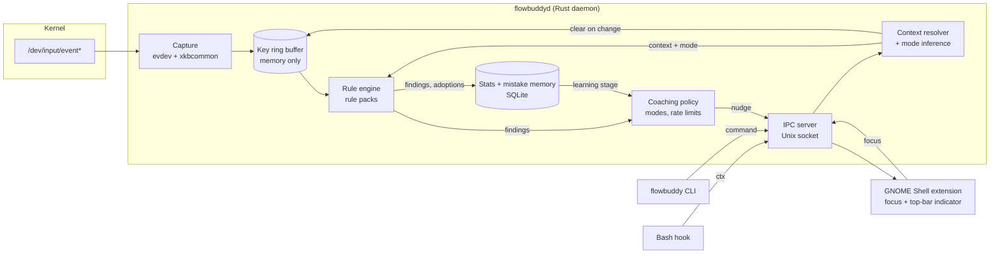

# Architecture

This document explains how Flow Buddy's pieces fit together. Privacy rules that apply everywhere are in [privacy.md](privacy.md). When this document and the code disagree, fix one of them.

## Components



| Component | Lives in | Responsibility |
|---|---|---|
| Capture | `crates/daemon` | Reads keyboards through evdev without grabbing them (#6). Translates keycodes into keys using xkbcommon (#7). |
| Key ring buffer | `crates/daemon` | Holds the last ~64 keys in memory, and only while a supported context is focused (#8). |
| IPC server | `crates/daemon` | Unix socket that speaks JSON lines; all other processes talk to the daemon through it (#10). |
| Context resolver | `crates/daemon`, model in `crates/core` | Combines focus and terminal reports into a `Context`, and infers the Vim mode (#13–#16). |
| Rule engine | `crates/core` (trait), `crates/daemon` (packs) | Turns keys plus context into findings and adoptions (#17–#22). |
| Coaching policy | `crates/core` | Decides whether, when and what to nudge, based on the mode, rate limits and learning stage (#23, #25). |
| Stats + mistake memory | `crates/daemon` | Stores aggregates, pattern records and abstract episodes in SQLite (#27, #30–#33). |
| GNOME Shell extension | `gnome-extension/` | Reports the focused window and shows nudges in the top bar (#11, #24). |
| Bash hook | `shell/flowbuddy.bash` | Reports the foreground command *name* for each shell (#12). |
| CLI | `crates/cli` | `status`, `mode`, `pause`, `rules`, `summary`, `memory`, `ctx` |

### Data flow for one key

1. Capture reads a key event and translates it, e.g. into `j`.
2. If the current context is `Unsupported`, the key is dropped right away.
3. Otherwise the key is pushed into the ring buffer and passed to mode inference, which updates the mode and its confidence.
4. If the mode is confident, the engine hands `(key, mode, context)` to each rule that is enabled for this context.
5. A rule may emit a `Finding` (an inefficiency) or an `Adoption` (you used the better command). Both update stats and the mistake memory, as counts and shapes only.
6. The coaching policy decides whether a finding becomes a nudge now, later (batched), or never.

## Context model

```rust
enum ContextKind {
    VsCodeVim,   // VS Code focused (vscodevim assumed)
    TerminalVim, // terminal focused, foreground command is vim/vi
    BashVi,      // terminal focused, shell at prompt, vi-mode on
    Unsupported, // anything else: keys are dropped
}

enum VimMode { Normal, Insert, Visual, VisualLine, VisualBlock, Cmdline, OpPending }

struct Context {
    kind: ContextKind,
    mode: VimMode,    // readline vi uses only Normal/Insert
    confident: bool,  // rules fire only when true
}
```

### Resolving the context

| Focused app (from extension) | Terminal report (from hook) | Context |
|---|---|---|
| VS Code (`code`, `code_code` for the snap) | — | `VsCodeVim` |
| Terminal emulator | foreground `vim`/`vi`/`nvim` | `TerminalVim` |
| Terminal emulator | at prompt (`ctx prompt`) | `BashVi` |
| Terminal emulator | other foreground command, or no report | `Unsupported` |
| Anything else | — | `Unsupported` |

The app ids are defaults and can be overridden in the config. The exact values reported on GNOME 50 are checked in #5.

**Matching a terminal window to a shell.** The extension reports the focused window's PID, and each hook report carries the shell's `$$` and TTY. The daemon walks the shell's parent processes until it reaches the window PID.

**Open question for #5:** GNOME Terminal and Ptyxis run one server process for all their windows, so several shells can match the same window. Until there's a better signal, the daemon uses the shell that reported most recently.

### Mode inference and confidence

- Mode is inferred from keys by a state machine for each context (#14, #15).
- **Esc** (or `Ctrl-[`) always resyncs to Normal and sets `confident = true`.
- Anything the daemon can't see sets `confident = false` until the next Esc. Examples: a mouse click, opening the VS Code command palette, a focus change, or an unrecognized key sequence (#16).
- Rules never fire while `confident` is false. This avoids false nudges, at the cost of missing some real ones.

## Coaching modes

| Mode | Captures | Live nudges | Summary |
|---|---|---|---|
| `off` | No (buffer cleared) | No | On demand, past data only |
| `passive` | Yes | No | On demand + one end-of-day notification |
| `balanced` (default) | Yes | Batched: up to 1–2 tips every N minutes (default 30) | On demand |
| `active` | Yes | Real time, with a cooldown per rule and a cap per hour | On demand |

These apply in every mode:
- quiet hours
- `pause <duration>`
- muting individual rules
- no nudges for patterns the mistake memory marks as `mastered`

Nudges come back once a pattern `regressed`.

**Learning stages** (#31): `new → nudged → improving → mastered`, and `mastered → regressed → improving`. Moving between stages depends on how often the mistake happens and how often you adopt the better command, measured over sliding windows.

## IPC protocol v0

- **Transport:** Unix stream socket at `$XDG_RUNTIME_DIR/flowbuddy.sock`, file mode `0600`.
- **Framing:** one JSON object per line (UTF-8, `\n`-terminated).
- **Envelope:** every message has `v` (protocol version, currently `0`) and `type`.
  - Requests may carry an `id`, which the daemon echoes back in the reply.
  - When the daemon gets an unknown `v`, it replies with an `error` and closes the connection.
  - When it gets an unknown `type`, it replies with an `error` and keeps the connection open.

The first message on every connection is `hello`. Short-lived clients (the CLI, the bash hook) send `hello` followed by one request, then disconnect. The extension stays connected and receives `nudge` messages pushed by the daemon.

### Client → daemon

**`hello`**: identifies the client.
```json
{"v":0,"type":"hello","client":"gnome-extension","client_version":"0.1.0"}
```
`client` is one of `gnome-extension`, `cli` or `bash-hook`.

**`focus`**: the focused window changed. Sent by the extension.
```json
{"v":0,"type":"focus","app_id":"code_code","title":"main.rs - Flow-Buddy - Visual Studio Code","pid":41230}
```
`title` is used only for classification and is never stored. When nothing is focused, `app_id` is `null`.

**`ctx`**: report from the shell hook. Sent once when a command starts and once when the prompt returns.
```json
{"v":0,"type":"ctx","event":"fg","command":"vim","shell_pid":51002,"tty":"/dev/pts/3"}
{"v":0,"type":"ctx","event":"prompt","vi_mode":true,"shell_pid":51002,"tty":"/dev/pts/3"}
```
`command` is the basename of the command only, never its arguments. `vi_mode` comes from checking `$SHELLOPTS` for `vi`. If it's false, the daemon treats the prompt as `Unsupported`.

**`nudge_response`**: the user acted on a nudge in the indicator.
```json
{"v":0,"type":"nudge_response","nudge_id":"n-1729740000-3","action":"dismiss"}
```
`action` is one of `seen` (shown and timed out), `dismiss`, `mute_rule` or `false_positive`.

**`command`**: a request from the CLI or the indicator menu.
```json
{"v":0,"type":"command","id":7,"name":"status"}
{"v":0,"type":"command","id":8,"name":"set_mode","args":{"mode":"active"}}
{"v":0,"type":"command","id":9,"name":"pause","args":{"seconds":3600}}
{"v":0,"type":"command","id":10,"name":"resume"}
{"v":0,"type":"command","id":11,"name":"rule","args":{"rule_id":"vim.repeat-jk","action":"disable"}}
{"v":0,"type":"command","id":12,"name":"summary","args":{"period":"today"}}
```
`summary` and `memory` read SQLite directly in the CLI (which is read-only). Going through the daemon is still allowed, so the extension can use the same requests.

### Daemon → client

**`welcome`**: the reply to `hello`.
```json
{"v":0,"type":"welcome","daemon_version":"0.1.0","mode":"balanced"}
```

**`ack`**: a request succeeded and has no other result.
```json
{"v":0,"type":"ack","id":8}
```

**`result`**: a request succeeded and returns data.
```json
{"v":0,"type":"result","id":7,"data":{"running":true,"mode":"balanced","paused_until":null,"context":"VsCodeVim","clients":["gnome-extension"]}}
```
`status` reports the *kind* of context, never keys or titles.

**`error`**: something went wrong.
```json
{"v":0,"type":"error","id":11,"code":"unknown_rule","message":"no rule named vim.repeat-jk"}
```
`code` is one of `bad_version`, `bad_request`, `unknown_type`, `unknown_rule` or `internal`.

**`nudge`**: shows a hint. Pushed to the extension.
```json
{"v":0,"type":"nudge","nudge_id":"n-1729740000-3","rule_id":"vim.repeat-jk","title":"Try a count","text":"You pressed j 7 times. Try 7j, } or Ctrl-d.","ttl_ms":6000}
```
In `balanced` mode, one batch may contain several `nudge` messages.

**`mode_changed`**: the coaching mode changed. Broadcast to clients that stay connected, so the indicator stays in sync.
```json
{"v":0,"type":"mode_changed","mode":"active","paused_until":null}
```

## Storage layout

| Path | Contents |
|---|---|
| `~/.config/flowbuddy/config.toml` | Mode, intervals, quiet hours, rule settings, app-id overrides, keyboard layout |
| `~/.local/share/flowbuddy/flowbuddy.db` | Stats, pattern records and episodes (schemas in #27 and #30) |
| `$XDG_RUNTIME_DIR/flowbuddy.sock` | IPC socket (exists only while the daemon runs) |

## Process model

- `flowbuddyd` runs as a systemd `--user` service (#9). It is the only process that reads `/dev/input`.
- The GNOME extension runs inside GNOME Shell and reconnects with backoff when the daemon restarts.
- The bash hook runs `flowbuddy ctx …` in the background, so the shell never waits on the daemon. If the socket is missing, the hook does nothing.
